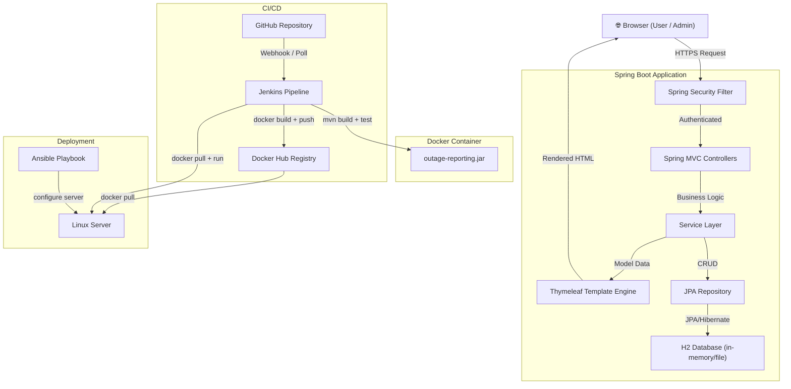

# Architecture Document
## Electricity Outage Reporting System
**Version:** 1.0 | **Date:** October 2026

---

## 1. System Overview

The Electricity Outage Reporting System is a monolithic Spring Boot web application
following the Model-View-Controller (MVC) pattern. It is packaged as a Docker image
and deployed via a Jenkins CI/CD pipeline, with infrastructure configuration managed by Ansible.

---

## 2. Architecture Diagram



---

## 3. Layer Responsibilities

### Presentation Layer (Thymeleaf + CSS + JS)
- Renders HTML pages from server-side data
- `templates/dashboard/` — Dashboard with stats cards
- `templates/reports/` — List, create, edit, detail pages
- `templates/auth/` — Login page
- `templates/fragments/` — Reusable navbar and alert components
- `static/css/main.css` — Custom utility-themed stylesheet
- `static/js/main.js` — Client-side UX (confirmations, debounce, dismiss)

### Controller Layer (`controller/`)
| Class | Responsibility |
|---|---|
| `DashboardController` | GET `/` — serves dashboard with live stats |
| `OutageReportController` | CRUD operations: list, view, create, edit, status update, delete |
| `AuthController` | GET `/login` — serves login page |

### Service Layer (`service/`)
| Class | Responsibility |
|---|---|
| `OutageReportService` | Interface defining all business operations |
| `OutageReportServiceImpl` | Implementation: CRUD, search, dashboard stats, transactions |

### Repository Layer (`repository/`)
| Class | Responsibility |
|---|---|
| `OutageReportRepository` | Spring Data JPA — CRUD + custom JPQL search queries |

### Model Layer (`model/`, `dto/`)
| Class | Responsibility |
|---|---|
| `OutageReport` | JPA entity mapped to `outage_report` table |
| `OutageStatus` | Enum: REPORTED, IN_PROGRESS, RESOLVED |
| `OutageReportDto` | Form-binding DTO with Bean Validation annotations |
| `DashboardStatsDto` | Carries dashboard counts to the view |

### Config Layer (`config/`)
| Class | Responsibility |
|---|---|
| `SecurityConfig` | Spring Security: BCrypt, in-memory users, URL permissions |
| `DataInitializer` | Seeds sample data on startup (dev/test only) |

### Exception Layer (`exception/`)
| Class | Responsibility |
|---|---|
| `OutageReportNotFoundException` | Thrown when a report ID doesn't exist (→ 404) |
| `GlobalExceptionHandler` | `@ControllerAdvice` — maps exceptions to error pages |

---

## 4. Security Architecture

```
Request → Spring Security Filter Chain
    ├── Public: /login, /css/**, /js/**, /actuator/health
    ├── Admin-only: /h2-console/**
    └── All others → require authentication
        ├── ROLE_USER  → can: view dashboard, list reports, view detail, CREATE
        └── ROLE_ADMIN → all USER permissions + edit, status update, delete
```

Method-level security via `@PreAuthorize("hasRole('ADMIN')")` on controller methods.
Passwords hashed with BCrypt (cost factor 10).

---

## 5. Database Schema

```sql
CREATE TABLE outage_report (
    id            BIGINT        NOT NULL AUTO_INCREMENT PRIMARY KEY,
    title         VARCHAR(150)  NOT NULL,
    location      VARCHAR(255)  NOT NULL,
    description   VARCHAR(2000) NOT NULL,
    reporter_name VARCHAR(100)  NOT NULL,
    status        VARCHAR(20)   NOT NULL CHECK (status IN ('REPORTED','IN_PROGRESS','RESOLVED')),
    created_at    TIMESTAMP     NOT NULL DEFAULT CURRENT_TIMESTAMP,
    updated_at    TIMESTAMP     NOT NULL DEFAULT CURRENT_TIMESTAMP ON UPDATE CURRENT_TIMESTAMP
);
```

**Development:** H2 in-memory (`spring.jpa.hibernate.ddl-auto=create-drop`)
**Production recommendation:** H2 file mode or PostgreSQL with Flyway migrations

---

## 6. Docker Architecture

```
┌─────────────────────────────────────┐
│   Docker Container                   │
│   Base: eclipse-temurin:21-jre-alpine│
│                                     │
│   USER: appuser (non-root)          │
│   WORKDIR: /app                     │
│   EXPOSE: 8080                      │
│   VOLUME: /app/data (for H2 files)  │
│                                     │
│   CMD: java -jar app.jar            │
└──────────────────┬──────────────────┘
                   │
                   │ port 8080
                   ▼
            Host machine / server
```

**Multi-stage build:**
1. `eclipse-temurin:21-jdk-alpine` — downloads deps, compiles, packages JAR
2. `eclipse-temurin:21-jre-alpine` — copies only the JAR → smaller image

---

## 7. CI/CD Pipeline (Jenkins)

```
Stage 1: Checkout      → git clone / checkout
Stage 2: Build         → mvnw compile
Stage 3: Test          → mvnw verify (JUnit + MockMvc)
Stage 4: Selenium      → mvnw verify -Pselenium (optional)
Stage 5: Reports       → Publish JUnit XML results
Stage 6: Package       → mvnw package -DskipTests
Stage 7: Docker Build  → docker build -t image:tag
Stage 8: Push + Deploy → docker push; docker run (main branch only)
Stage 9: Health Check  → GET /actuator/health; fail pipeline if not 200
```

---

## 8. Deployment Architecture

```
Developer → GitHub → Jenkins → Docker Hub → Linux Server
                                               ↑
                                          Ansible provisions
                                          Docker + directories
                                          + docker-compose.yml
```

---

## 9. Key Design Decisions

| Decision | Rationale |
|---|---|
| Monolithic architecture | Appropriate for college project scope; simpler to deploy and explain |
| H2 in-memory database | Zero configuration for development; swap to file-mode or PostgreSQL for production |
| Thymeleaf server-side rendering | Simpler than a separate SPA; works without JavaScript for accessibility |
| Maven Wrapper | Reproducible builds without requiring Maven installed on every machine |
| Non-root Docker user | Security best practice; reduces container attack surface |
| `@PreAuthorize` on methods | Enforces authorization at the service boundary, not just in HTML |
| DataInitializer `@Profile("!prod")` | Sample data only in dev — never in production containers |
