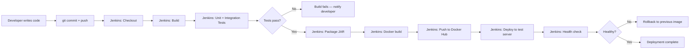

# Software Requirements Specification (SRS)
## Electricity Outage Reporting System
**Version:** 1.0 | **Date:** October 2026 | **Author:** Yash Gade

---

## 1. Problem Statement

Electricity outages disrupt daily life, businesses, and public safety. Citizens currently have no standardized way to report outages to their utility provider — they rely on phone calls or social media posts, causing delays in response, duplicate reports, and poor tracking.

This project provides a centralized web application where:
- Citizens report outages quickly with location and description
- Utility staff track and update resolution status
- Both parties can see real-time progress

---

## 2. Target Users and Stakeholders

| Stakeholder | Role |
|---|---|
| **Citizens / Residents** | Report outages, check status of their reports |
| **Utility Field Staff** | View pending reports, update status as work progresses |
| **Utility Administrators** | Manage all reports, edit, delete, generate summaries |
| **IT / DevOps Team** | Deploy, monitor, and maintain the application |

---

## 3. Project Objectives

1. Enable citizens to submit electricity outage reports through a web interface
2. Allow utility staff to manage reports with status updates
3. Provide a dashboard showing live counts by status
4. Enforce role-based access so only authorized users perform administrative actions
5. Demonstrate a complete DevOps pipeline: build → test → Docker → Jenkins → Ansible

---

## 4. Functional Requirements

| ID | Requirement |
|---|---|
| FR-01 | Users shall log in with a username and password |
| FR-02 | Users shall be able to create an outage report with title, location, description, and reporter name |
| FR-03 | The system shall validate all required fields and display field-level error messages |
| FR-04 | Users shall view a paginated list of all outage reports |
| FR-05 | Users shall search reports by keyword (title, location, description, reporter) |
| FR-06 | Users shall filter reports by status (REPORTED, IN_PROGRESS, RESOLVED) |
| FR-07 | Users shall view the full details of any single report |
| FR-08 | Administrators shall edit report title, location, description, and reporter name |
| FR-09 | Administrators shall update the status of any report |
| FR-10 | Administrators shall permanently delete a report after confirmation |
| FR-11 | The dashboard shall display live counts: total, reported, in-progress, resolved |
| FR-12 | The system shall display success and error messages after user actions |
| FR-13 | The system shall store data persistently in a configured database |
| FR-14 | The system shall expose a health check endpoint at `/actuator/health` |

---

## 5. Non-Functional Requirements

| ID | Requirement |
|---|---|
| NFR-01 | **Security:** Passwords stored with BCrypt hashing. Permissions enforced server-side |
| NFR-02 | **Performance:** Page response time under 2 seconds for up to 1,000 records |
| NFR-03 | **Usability:** Responsive design; usable on mobile screens (≥ 375px width) |
| NFR-04 | **Reliability:** Application starts cleanly on each container restart |
| NFR-05 | **Maintainability:** Layered architecture (controller → service → repository) |
| NFR-06 | **Testability:** Unit and integration tests covering core business logic and controllers |
| NFR-07 | **Portability:** Runs inside a Docker container without host-level configuration |
| NFR-08 | **Observability:** Structured logging with configurable log levels |

---

## 6. Constraints and Assumptions

**Constraints:**
- Must run on a standard Windows development laptop for local testing
- H2 in-memory database is acceptable for the MVP (data loss on restart is known)
- No real utility company data will be used — all sample data is fictional

**Assumptions:**
- A single authentication source (in-memory users) is sufficient for the MVP
- The application serves a single institution (no multi-tenancy required)
- Users have a modern web browser (Chrome, Firefox, Edge, Safari)

---

## 7. Measurable Success Criteria

| Criteria | Target |
|---|---|
| All unit tests pass | 100% |
| All integration tests pass | 100% |
| Application starts in Docker container | ✅ Verified |
| Dashboard shows correct counts | Verified against DB |
| Admin actions blocked for regular users | Verified with 403 response |
| Selenium tests pass (with Chrome) | 8/8 test scenarios |
| Jenkins pipeline completes all stages | All 9 stages green |

---

## 8. MVP Scope

**In scope:**
- User login and logout
- Create outage report
- View all reports (paginated, searchable, filterable)
- View report detail
- Edit report (admin)
- Update status (admin)
- Delete report (admin)
- Dashboard with live counts
- Docker image build
- Jenkins pipeline (build, test, package, Docker, deploy)
- Ansible playbook for Linux deployment

**Out of scope (future enhancements):**
- Email / SMS notifications
- Google Maps integration
- Photo attachments
- PostgreSQL production database
- User self-registration
- Multi-language support
- Report export (CSV/PDF)
- Rate limiting / DDoS protection

---

## 9. Use Cases

### UC-01: Submit Outage Report
**Actor:** Citizen (USER role)
**Precondition:** User is logged in
**Steps:**
1. Click "Report Outage" in the navigation
2. Fill in title, location, description, and name
3. Submit the form
**Expected outcome:** Report saved with REPORTED status. Redirect to detail page with success message.
**Alternate flow:** Missing required field → form redisplays with field-level error messages

### UC-02: Update Report Status
**Actor:** Administrator (ADMIN role)
**Precondition:** Admin is logged in. Report exists.
**Steps:**
1. Navigate to report detail
2. Select new status from dropdown
3. Click "Update Status"
**Expected outcome:** Status updated. Success message displayed.
**Authorization check:** Regular USER receives 403 Forbidden if they attempt this action directly.

### UC-03: Search for Reports
**Actor:** Any authenticated user
**Steps:**
1. Navigate to All Reports
2. Enter keyword in search box or select a status filter
3. Results update to show matching records
**Expected outcome:** Only matching records shown. Empty state displayed if none found.

---

## 10. Database Model

```
TABLE outage_report
┌─────────────────┬─────────────┬──────────────────────────┐
│ Column          │ Type        │ Constraints              │
├─────────────────┼─────────────┼──────────────────────────┤
│ id              │ BIGINT      │ PK, AUTO_INCREMENT        │
│ title           │ VARCHAR(150)│ NOT NULL                 │
│ location        │ VARCHAR(255)│ NOT NULL                 │
│ description     │ VARCHAR(2000)│ NOT NULL                │
│ reporter_name   │ VARCHAR(100)│ NOT NULL                 │
│ status          │ VARCHAR(20) │ NOT NULL, ENUM value     │
│ created_at      │ TIMESTAMP   │ NOT NULL, auto-set       │
│ updated_at      │ TIMESTAMP   │ NOT NULL, auto-updated   │
└─────────────────┴─────────────┴──────────────────────────┘

Status values: REPORTED | IN_PROGRESS | RESOLVED
```

---

## 11. User Stories

| ID | Story | Acceptance Criteria |
|---|---|---|
| US-01 | As a citizen, I want to submit an outage report so the utility knows about the problem | Form submits → record saved → success message shown |
| US-02 | As a citizen, I want to see the status of my report so I know if it's being worked on | Report detail page shows current status with timestamp |
| US-03 | As staff, I want to see all pending reports so I can prioritize work | Report list filtered by REPORTED status |
| US-04 | As staff, I want to update status to IN_PROGRESS so citizens know work has started | Status update form → DB updated → status badge changes |
| US-05 | As an admin, I want to delete duplicate reports to keep data clean | Delete requires confirmation → record removed from DB |
| US-06 | As a user, I want to search by location so I can find relevant reports quickly | Keyword search returns matching records |
| US-07 | As staff, I want a dashboard so I can see the overall situation at a glance | Dashboard cards show live counts by status |

---

## 12. Product Backlog (Priority Order)

| Priority | Item | Status |
|---|---|---|
| 1 | Project setup and Spring Boot scaffold | ✅ Done |
| 2 | Database model and JPA repository | ✅ Done |
| 3 | Service layer with CRUD and search | ✅ Done |
| 4 | REST-style MVC controllers | ✅ Done |
| 5 | Thymeleaf templates (all pages) | ✅ Done |
| 6 | Spring Security (login, roles) | ✅ Done |
| 7 | Validation and error handling | ✅ Done |
| 8 | Dashboard with live stats | ✅ Done |
| 9 | Unit and integration tests | ✅ Done |
| 10 | Selenium browser tests | ✅ Done |
| 11 | Dockerfile and Docker image | ✅ Done |
| 12 | Jenkins declarative pipeline | ✅ Done |
| 13 | Ansible playbook | ✅ Done |
| 14 | Documentation | ✅ Done |
| 15 | GitHub repository and push | 🔲 Pending (run git push) |

---

## 13. 15-Week Implementation Plan

| Week | Phase | Deliverable |
|---|---|---|
| 1 | Planning | SRS, architecture diagram, backlog |
| 2 | Setup | Maven project, Git init, GitHub repo |
| 3 | Model/Repo | OutageReport entity, JPA repository |
| 4 | Service Layer | Service interface + implementation |
| 5 | Controllers | CRUD controllers, routing |
| 6 | Templates | Thymeleaf pages, CSS, JS |
| 7 | Security | Spring Security, login, roles |
| 8 | Validation | Bean Validation, error pages |
| 9 | Testing | Unit tests (JUnit + Mockito) |
| 10 | Testing | Integration tests (MockMvc) |
| 11 | Docker | Dockerfile, build, run in container |
| 12 | Jenkins | Jenkinsfile, pipeline configuration |
| 13 | Selenium | Browser tests, CI integration |
| 14 | Ansible | Playbook, inventory, idempotency test |
| 15 | Finalization | Documentation, evidence, viva prep |

---

## 14. Definition of Done

A feature is considered **Done** when:
- [ ] Code is written and follows the package structure
- [ ] Unit or integration tests cover the feature
- [ ] The application runs without errors with the feature active
- [ ] Relevant UI pages display correct data
- [ ] Code is committed to Git with a meaningful message
- [ ] No hardcoded secrets in source code
- [ ] Documentation updated if the feature is user-facing

---

## 15. Development-to-Operations Workflow


